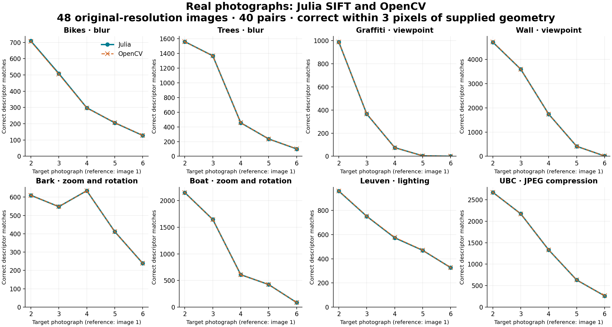

# Real-photograph validation — 2026-10-09

**Result: PASS**, with 768 explicit checks and 0 failures. The Julia implementation was tested on all 48 original-resolution photographs in eight Oxford sequences, against OpenCV 4.10.0 and the supplied homographies. The package source was unchanged during this test.

Runtime: julia version 1.13.1; OpenCV 4.10.0; NumPy 2.3.5; Python 3.14.4. The photo run used Python optimization level 1; explicit gates remained active. Run ID: `d287935e32204b6f9db0c1cd1bf82709`.

The initial photo run preceded the final octave and tiny-ratio repairs.
Prepublication verification recomputed all 48 original photographs with the
current package and confirmed byte-identical keypoint and descriptor outputs.
The ordinary 0.8 matching predicate is unchanged for these Float32 descriptors.

## Numerical agreement

- 249,561 Julia feature instances and 249,572 OpenCV instances; 249,484 geometry-only one-to-one pairs (99.9647% coverage across all frames).
- Lowest coverage on any individual photograph: 99.5497%.
- Lowest per-image median descriptor cosine similarity: 0.99998057 (1 means identical directions).
- Worst per-image p95 position difference: 0.000430 px; relative scale difference: 2.10241e-05; orientation difference: 0.002935°.
- Fixed-frame descriptors, descriptor norms, cross-library retrieval, and matching the same descriptors with Julia versus BFMatcher were also checked.

## Matching against independent geometry

Across 40 reference/target pairs, Julia returned 38,554 descriptor matches, of which 34,989 landed within 3 pixels of the published transformation (90.753% pooled precision). OpenCV returned 38,572 matches, with 34,995 correct (90.726%).

A separately fitted homography had mean error below 3 pixels at five fixed source-image probes on 33/40 Julia pairs and 32/40 OpenCV pairs. Fit accuracy is scored against the supplied homography, not the RANSAC mask.

| Scene | Change | Lowest frame coverage | Correct matches: Julia / OpenCV¹ | Accurate homographies: Julia / OpenCV² |
|---|---|---:|---:|---:|
| bikes | blur | 99.7249% | 1,850 / 1,843 | 5 / 4 |
| trees | blur | 99.9217% | 3,721 / 3,722 | 3 / 3 |
| graf | viewpoint | 99.9356% | 1,434 / 1,435 | 3 / 3 |
| wall | viewpoint | 99.9308% | 10,466 / 10,473 | 3 / 3 |
| bark | zoom rotation | 99.9286% | 2,444 / 2,444 | 5 / 5 |
| boat | zoom rotation | 99.9230% | 4,914 / 4,912 | 4 / 4 |
| leuven | illumination | 99.9078% | 3,084 / 3,090 | 5 / 5 |
| ubc | jpeg compression | 99.5497% | 7,076 / 7,076 | 5 / 5 |

¹ Sum of correct descriptor matches across the five target images. ² Out of five pairs, using the mean error at the five probes.



## Difficult cases

A compatibility pass does not mean every scene pair matched successfully. Standard SIFT loses correspondences under sufficiently severe foreshortening, blur, and scale change. The following original-resolution pairs had fewer than 20 correct matches in at least one implementation:

| Pair | Julia: matches / correct | OpenCV: matches / correct | Mean fitted-homography error: Julia / OpenCV (px) |
|---|---:|---:|---:|
| graf_1 → graf_5 | 107 / 4 | 109 / 4 | 379.57 / 320.90 |
| graf_1 → graf_6 | 86 / 0 | 87 / 0 | 507.87 / 691.53 |
| wall_1 → wall_6 | 64 / 11 | 63 / 11 | 3.07 / 3.07 |

Local diagnostic match plots can be generated with `--figures /path/to/figures` (requires matplotlib). The publication includes the measured-result chart; downloaded photographs and image-overlay diagnostics remain local.

## Protocol and acceptance gates

Both libraries receive exactly the same decoded grayscale UInt8 pixels. This primary run does not resize or cap features. Parameters are three layers per octave, contrast 0.04, edge threshold 10, sigma 1.6, and a doubled first octave. OpenCV precise upscaling is explicitly enabled. Coordinates are converted to zero-based pixels, sigma to half OpenCV keypoint size, and angles to radians. OpenCV descriptor vectors are L2-normalized for comparison.

Keypoint pairing uses position <1 px, absolute log-scale ratio <0.05, and circular angle difference <5°. It uses no descriptors to choose pairs. Each image must have >30 pairs and ≥97% coverage, p95 position <0.01 px, relative scale error <0.005, angle error <0.1°, median detected-frame descriptor cosine >0.999, and p05 fixed-frame cosine >0.995. Cross-library retrieval must cover ≥80% of the smaller feature set with ≥95% geometric precision.

Descriptor matching uses a strict 0.8 Lowe ratio and mutual nearest neighbors. Published H1toNp matrices map image-1 pixel centers into image-N coordinates. A match is correct when its forward projection error is <3 px. The matcher must give the same pair set as the BFMatcher-based reference when both use the same descriptors. Separate library outputs must have match counts within 10% plus two, correct-match count at least 90% of OpenCV minus two, and precision no more than five percentage points below OpenCV. If OpenCV produces an accurate homography, Julia matches must also produce one.

Homography fitting uses OpenCV RANSAC with seed 7, 3-pixel threshold, 10,000 maximum iterations, and confidence 0.999 on each library’s matches. The five evaluation probes are the center and the four points at 10%/90% of the source image dimensions. The geometric gate is mean probe error <3 px. The fit is validation machinery; SIFTFeatures itself does not implement RANSAC.

The thresholds were set in the harness before the original-resolution run. These are empirical integration checks, not the official Oxford affine-region overlap/repeatability protocol or a published benchmark ranking.

## Resized cross-check

A preliminary, uncapped run of the same 48 photographs at maximum side 640 also passed its numerical/matching gates: 144,783 / 144,791 Julia/OpenCV feature instances, 144,745 paired frames, and 24,509 / 24,519 correct matches among 26,207 / 26,215 descriptor matches. That earlier protocol did not yet include the fitted-homography comparison gate. The original-resolution report above includes it. Resizing maps include the pixel-center half-pixel offset; each homography is conjugated with the actual source/target maps.

## Validation integrity and Julia regression tests

The previous Python assertion-removal issue is repaired: explicit checks collect failures, reports are written on failure, exit status is nonzero, and a pending failed-state report replaces any stale success before work starts. Deliberately zeroing descriptors is rejected in both normal and optimized Python, with `passed=false`. Seven harness tests passed in both modes for the photographic run; the current suite has eight, including non-finite report handling. All 98 Julia tests passed with bounds checking enabled for this historical
run. Publication preparation expands the suite to 132 Julia checks on both Julia 1.10.0 and 1.13.1; see the
[prepublication verification](../validation/prepublication-results.json).

- [Descriptor-corruption control](../validation/guard-negative-control.txt)
- [Machine-readable original-resolution results](../validation/real-world-results.json)
- [Machine-readable resized results](../validation/real-world-resized-results.json)
- [Pinned sources and individual file hashes](../validation/oxford-sources.json)
- [Exact dataset-manifest snapshot used by these runs](../validation/run-snapshots/oxford-sources.json)

The current manifest labels its retrieval date in the user’s local timezone. The exact original manifest bytes, whose hash is recorded in both run reports, are preserved in the linked run snapshot. Archive and image hashes are unchanged.

## Scope and reproduction

This strengthens the photographic evidence across eight scenes. It remains a small benchmark of planar scenes or fixed-center camera acquisitions; it does not establish robustness to arbitrary 3D viewpoint changes, moving objects, every camera pipeline, or every platform. Publication preparation adds independent Julia descriptor-layout tests and explicit singleton-octave guards. Float64 filtering allocations remain a profiling target; see the [implementation notes](implementation.md).

From the package directory, after installing `validation/requirements.txt`:

```sh
python validation/download_oxford.py --data-dir validation-data
python -O validation/real_world.py --data-dir validation-data \
    --work-dir validation-work --max-side 0
```

Use `--julia /path/to/julia` if required. The optional manually triggered GitHub workflow is included; hosted execution has not been run here.

Data: [Oxford affine covariant regions](https://www.robots.ox.ac.uk/~vgg/research/affine/). K. Mikolajczyk et al., *A comparison of affine region detectors*, IJCV 65(1/2), 2005. The benchmark documentation describes gradually changing camera focus, zoom, viewpoint, aperture, and JPEG quality. Images are retained only in local scratch storage; plots are diagnostic derivatives.
